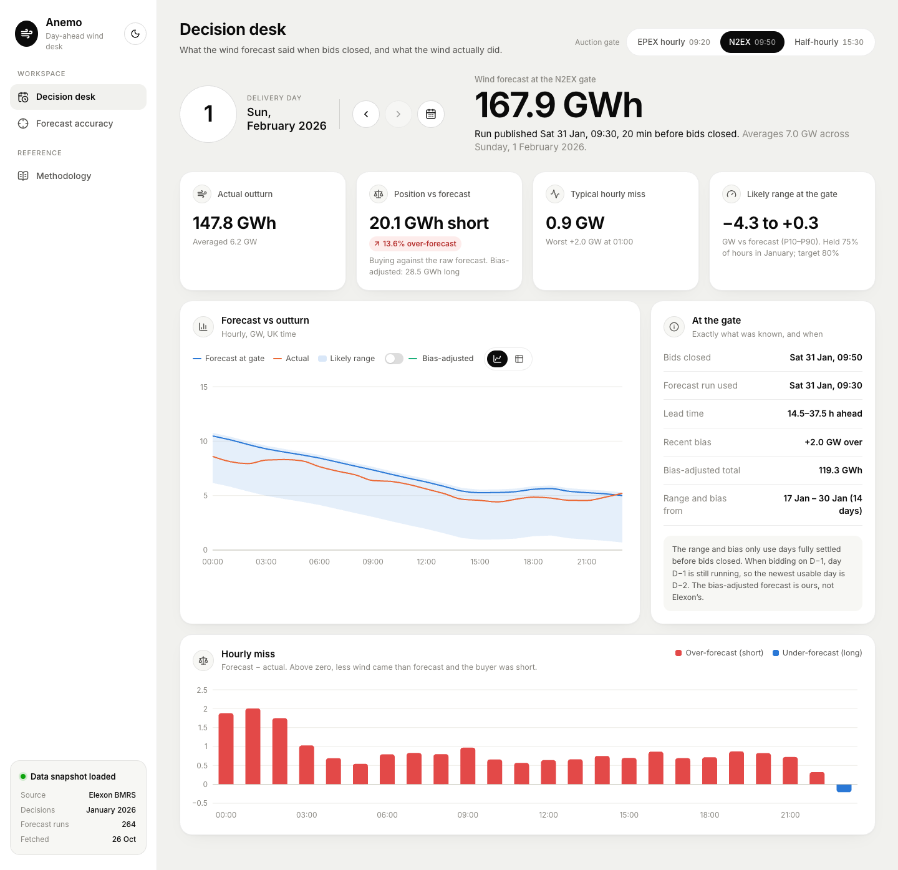
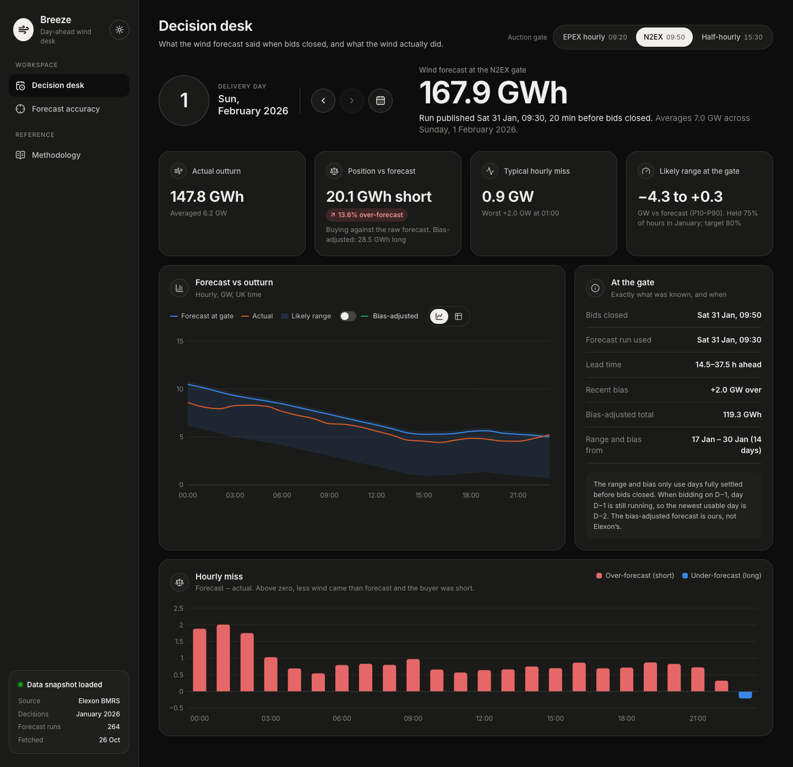

# Breeze: day-ahead wind forecast desk

**B**ias, **R**ange and **E**rror **E**valuation, with **Z**ero-hindsight **E**stimates.

A web app for a UK utility's day-ahead power buying team. For every delivery day it shows **the national wind forecast that was available when the auction gate closed**, and **how accurate that forecast is**. The team can then size purchases with the error in mind.

Data: Elexon BMRS only. `FUELHH` (fuel type WIND) provides actuals and `WINDFOR` provides forecasts. Scope is purchase decisions made in January 2026.

- **Backend** (Python, FastAPI): [backend/README.md](backend/README.md) covers the data findings, business rules, API and tests.
- **Frontend** (React, Vite, TypeScript): [frontend/README.md](frontend/README.md) covers the views, design system and charts.

| Light | Dark |
|---|---|
|  |  |

## Run it

**Heroku** (container stack):

```bash
heroku create <app-name> --stack container
git push heroku main          # Heroku builds the Dockerfile via heroku.yml
heroku open
```

**Docker** (one image: FastAPI serves the API and the built React app):

```bash
docker build -t breeze .
docker run --rm -p 8000:8000 breeze        # http://localhost:8000
# Hosts that assign a port (e.g. Heroku) set $PORT, and the image honours it
```

**Local development** (two terminals):

```bash
cd backend && python3.12 -m venv .venv && .venv/bin/pip install -r requirements-dev.txt
.venv/bin/uvicorn app.main:app --reload                 # :8000

cd frontend && npm install && npm run dev               # :5173, proxies /api to :8000
```

**Checks:**

```bash
cd backend && .venv/bin/python -m pytest -q             # 26 tests
cd frontend && npm run build && npm run lint            # type-check, build, lint
```

## Repository layout

```
backend/    FastAPI app, Elexon snapshot (data/), tests
frontend/   React app
docs/       screenshots
Dockerfile  multi-stage: node builds the frontend → python:3.12-slim runs everything
heroku.yml  tells Heroku's container stack to build the Dockerfile
```

## Status

Complete for the brief's scope: purchase decisions made in January 2026. It deploys to Heroku as a container (`heroku.yml` → root `Dockerfile`). The design choices are written up in the backend and frontend READMEs.

- **Live app:** https://breeze-wind-desk-36fe0c280db6.herokuapp.com/
- **Repository:** https://github.com/abhinav-usc/dhbcuiq2eh

**Headline (N2EX gate, January 2026):** the forecast ran **+1.73 GW high** on average, leaving a buyer **1,392 GWh short** over the month. A bias adjustment that uses only data available at the gate cuts the average error by 19% and the shortfall to 655 GWh. The likely range held 75% of hours, against an 80% target.

## Use of AI tools

This project was built with assistance from **Claude Code** (Anthropic's AI coding assistant) during development. In particular, Claude Code:

- Set up the infrastructure: project scaffolding, Docker and the Heroku deployment.
- Assisted with implementing the backend and frontend.
- Gathered research material and information, such as how the Elexon API behaves and when day-ahead auction gates close.

The author directed the work, led the analysis and made the design decisions, and reviewed and edited the code.
