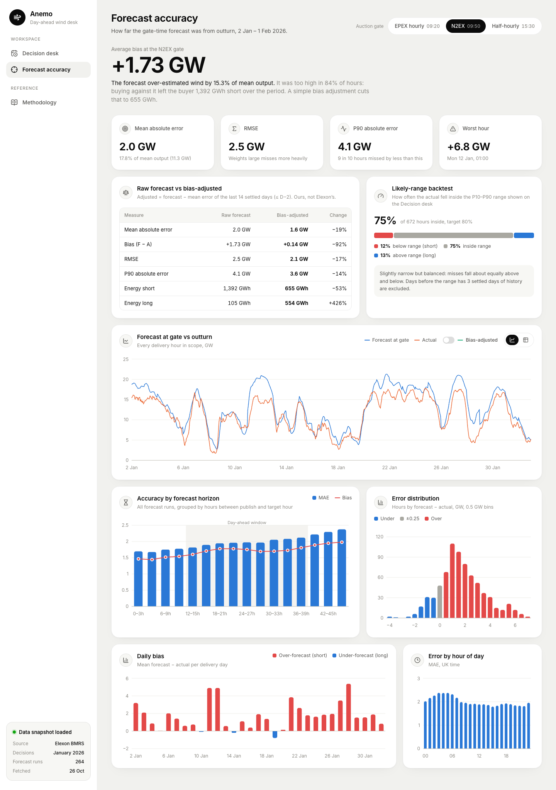

# Frontend: Anemo dashboard (React + Vite + TypeScript)

A three-view dashboard for a day-ahead power buying team:

1. **Decision desk:** for one delivery day, what the wind forecast said when bids closed, the likely range around it, and what actually happened. The day's error is shown as the buyer's *position* (e.g. "26.6 GWh short"). A switch overlays our **bias-adjusted** forecast.
2. **Forecast accuracy:** how wrong the gate-time forecast was across January: headline error measures, a **raw vs bias-adjusted** comparison, a **likely-range backtest** (how often actuals fell inside), and error by horizon, size, day and hour.
3. **Methodology:** every definition in plain English, for the client and for reviewers.

> **Status: v1, 27 Oct 2026.** All three views work against the real API, including the bias-adjusted forecast and the range backtest. Open choices are in [Decisions to discuss](#decisions-to-discuss).

| Decision desk | Forecast accuracy |
|---|---|
|  |  |

Also see [methodology.png](../docs/screenshots/methodology.png) and the [390 px phone layout](../docs/screenshots/decision-desk-mobile.png).

---

## Quick start

```bash
cd frontend
npm install
npm run dev        # http://localhost:5173. Needs the backend on :8000 (see ../backend/README.md)
npm run build      # type-check + production build into dist/
npm run lint       # oxlint
```

In dev, Vite proxies `/api/*` to `http://localhost:8000` (`vite.config.ts`). In Docker, FastAPI serves `dist/` and the API from the same origin, so the frontend always calls relative `/api/...` URLs and needs no environment config.

---

## Code layout

```
src/
├── main.tsx                 entry: font + global CSS + <App/>
├── App.tsx                  shell (sidebar + main), meta fetch, view/gate/day state ⇄ URL
├── index.css                design tokens + all styles (plain CSS, no framework)
├── api/
│   ├── types.ts             response types, mirroring backend/app/schemas.py by hand
│   └── client.ts            fetchJson (surfaces the API's error "detail") + URL builders
├── hooks/useApi.ts          fetch-on-path-change; keeps old data while refetching
├── lib/
│   ├── format.ts            GW/GWh/percent, UK-time dates, true minus sign, no "−0.0"
│   ├── theme.ts             chart colours (mirrors the CSS tokens; Recharts needs raw hex)
│   └── ticks.ts             round-number GW axis ticks; category-axis helpers
├── components/              presentational building blocks
│   ├── Sidebar, PageHeader, Card, KpiTile, DeltaPill
│   ├── SegmentedControl, GateSelector, DeliveryDayPicker, ViewToggle
│   ├── Legend, TooltipCard, DataTable, StatusViews
│   ├── Switch (adjusted-line toggle), CoverageBar (range backtest)
├── charts/                  one file per chart, all Recharts
│   ├── DayForecastChart     forecast + actual lines, likely-range band (Decision desk)
│   ├── DivergingBars        over/under-forecast bars around 0 (hourly miss, daily bias)
│   ├── MonthSeriesChart     744 hourly points, forecast vs actual
│   ├── HorizonChart         MAE bars + bias line by hours ahead, "day-ahead window" shaded
│   ├── ErrorHistogram       error distribution, zero-centred bins
│   └── HourOfDayChart       MAE by UK hour
└── views/                   one per screen; compose components + charts
    ├── DecisionDesk.tsx
    ├── AccuracyView.tsx
    └── MethodologyView.tsx
```

About 2,700 lines in total. There's no state library, no router and no CSS framework (see decisions 3 and 4 below).

---

## How it works

### State and URLs
`App.tsx` holds three pieces of state: **view**, **gate** and **delivery day**. They are written to the query string with `history.replaceState`, so any screen can be shared as a link, for example `/?view=decision&gate=n2ex&day=2026-01-15`. Bad values in the URL fall back to defaults: the API's default gate and the latest delivery day.

### Data fetching
`useApi(path)` fetches whenever `path` changes and aborts stale requests. **It keeps the previous data while the next request is in flight.** Views then dim the old render (`.is-refreshing`) instead of flashing a skeleton, so switching gate or day doesn't shift the layout. `loading` is *derived* (the last settled request was for a different path) rather than set inside the effect, which keeps React's lint rules happy.

| View | Endpoint |
|---|---|
| App boot | `GET /api/meta`: scope, gates, default gate, snapshot info |
| Decision desk | `GET /api/decision?delivery_day=…&gate=…` |
| Forecast accuracy | `GET /api/accuracy?gate=…` |

### Formatting conventions (`lib/format.ts`)
- Power arrives in MW and is shown in **GW**. Energy arrives in MWh and is shown in **GWh**.
- **Error sign:** `forecast − actual`. Positive = over-forecast = the buyer is *short*. That direction is always spelled out in words and icons, never left to colour alone.
- Timestamps are shown in **UK time** (`Europe/London`). Day strings are formatted in UTC so a date never shifts.
- A true minus sign (−). The sign is taken from the *rounded* value, so −20 MW shows as `0.0 GW`, never `−0.0 GW`.

---

## Design

The design is inspired by the reference shots: a warm light-grey page, white rounded cards, an ink-black active state, round icon chips, and one big hero number per view. The charts follow the **dataviz skill** method, which is a set of checks rather than taste.

**Tokens.** Every colour, radius and shadow is a CSS custom property at the top of `index.css`. Chart colours are mirrored in `lib/theme.ts`.

**Colour carries meaning, consistently across both views:**

| Role | Colour | Why |
|---|---|---|
| Forecast at gate | blue `#2a78d6` | Series slot 1 |
| Actual | orange `#eb6834` | Series slot 2 |
| Bias-adjusted (ours) | aqua `#1baf7a` | Series slot 3. All three pass the validator's all-pairs check. Aqua is 2.8:1 on white, so its values are also in the tooltip and table. |
| Over-forecast (short) | red `#e34948` | Pole of the diverging pair |
| Under-forecast (long) | blue `#2a78d6` | Other pole |
| "About right" (±0.25 GW) | grey `#a9a8a1` | Diverging midpoint, neutral |

Both pairs were run through the skill's palette validator against the white card surface. Both **pass every check**: lightness band, chroma, colour-vision-deficiency separation (ΔE 24.7 and 21.6; the target is ≥ 8), normal-vision separation, and ≥ 3:1 contrast.

**Marks.** 2 px lines (1.5 px on the dense 744-point month chart). Bars are at most 24 px wide with 4 px rounded data ends. Gridlines are solid hairlines. Y-axes use round GW ticks (`lib/ticks.ts`) instead of Recharts' defaults like 4.5 / 13.5.

**Readability.** Every chart with two or more series has a legend that mirrors its marks (stroke for lines, block for bars, wash for bands). There is one dark tooltip style everywhere: values bold first, labels second. The two main charts have a **chart/table toggle**, so every value can be read without hovering.

**Typography.** Inter (self-hosted via `@fontsource-variable/inter`, no Google Fonts call). Big numbers use proportional figures; table columns use `tabular-nums`.

**Responsive.** Down to 390 px. The sidebar becomes a horizontally scrollable top bar, the grids collapse to one column, and crowded axis labels are dropped instead of overlapping (`interval="preserveStartEnd"`). This was checked with a script that measures page overflow at a real 390 px viewport: no horizontal page scroll on any view.

---

## Verification done for v1

- `npm run build` (includes `tsc -b`) and `npm run lint` are clean.
- Every view was rendered in headless Chrome at 1440 px and 390 px and inspected. Two bugs were found this way and fixed:
  - Awkward y-ticks.
  - The likely-range band dipping below 0 GW. That one was fixed in the backend and covered by a test.
- Numbers on screen were cross-checked against the API, for example N2EX MAE 2.0 GW and bias +1.73 GW.
- The Docker image was built and run, and the screenshots above were taken from a live server.

**Not done:** no frontend unit tests or end-to-end tests yet (see next steps). No cross-browser check beyond Chrome. No screen-reader pass.

---

## Decisions to discuss

| # | Decision | v1 does | Alternatives | Notes |
|---|---|---|---|---|
| 1 | **Charting library** | Recharts 3 | visx, ECharts, Plotly, D3 | Declarative and quick to build with, but it accounts for most of the **655 kB JS bundle (192 kB gzipped)**. Vite warns about it, and code-splitting per view would fix it. |
| 2 | **API types** | Hand-written mirror of the Pydantic models | Generate from `/openapi.json` (e.g. `openapi-typescript`) | Codegen removes drift. It's worth doing once the API settles. |
| 3 | **Routing and state** | URL query params + `useState`, no router | React Router / TanStack Router | It's enough for 3 views. A router becomes worthwhile with nested screens or browser back/forward per filter. |
| 4 | **Data fetching** | Small custom `useApi` hook | TanStack Query | Query adds caching, retries and dev tools. The data is immutable, so v1 doesn't need it yet. |
| 5 | **Styling** | Plain CSS with tokens in one file | CSS Modules, Tailwind | One file (about 870 lines) is easy to review today. Split it if it grows. |
| 6 | **Dark mode** | Light only | Add a dark token set + toggle | The tokens are structured for it. Chart colours need their own validated dark steps, not an automatic flip. |
| 7 | **Product name** | "Anemo" (from *anemometer*) | Anything | Placeholder for the pitch. |
| 8 | **Headline metrics** | Decision desk: forecast GWh at the gate (hero), actual, position short/long, typical miss, likely range (with backtest %). Accuracy: bias (hero, with GWh short), MAE, RMSE, P90, worst hour, raw vs adjusted, coverage. | Fewer tiles; prices (out of scope: Elexon data only) | Confirm with the client. |
| 10 | **Adjusted line default** | Off, so the published forecast is the primary truth | On by default | Turn it on for the demo. |
| 9 | **Default delivery day** | The latest one (1 Feb) | The day with the biggest miss, or a picker landing page | Matters for the demo flow. |

## Known gaps and next steps

- Tests: Vitest for `format.ts` and `ticks.ts` (pure functions, easy wins), plus one Playwright smoke test per view.
- Code-split per view to get under Vite's 500 kB warning.
- Show half-hourly actuals as a thin line on the Decision desk chart (the API already has them).
- Accessibility pass: chart `aria-label` summaries, keyboard focus on chart points, a screen-reader check.
- The Decision desk could show how the forecast *changed* between earlier runs and the gate run.
